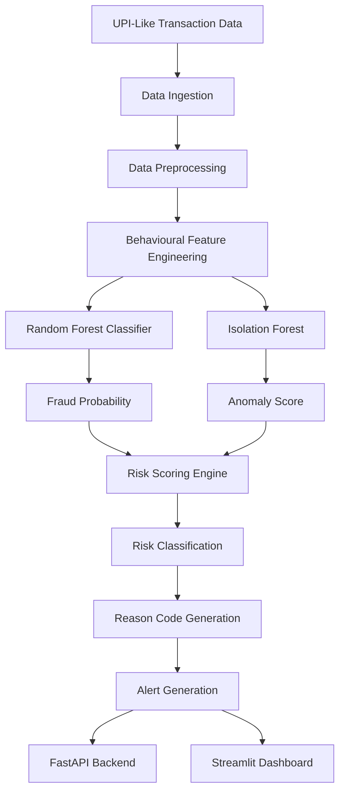

#  SentinelPay
### AI-Powered Real-Time UPI Fraud Detection and Financial Crime Intelligence

**Securing Digital Payments Through Intelligent Fraud Detection, Behavioural Analytics, and AI-Powered Financial Intelligence.**

---

##  Project Overview

**SentinelPay** is an AI-driven financial security platform designed to identify suspicious UPI transaction patterns through machine learning, anomaly detection, and behavioural analytics. It combines predictive intelligence, transaction risk assessment, and automated security alerts to support proactive financial fraud monitoring.

The platform leverages machine learning algorithms such as **Random Forest, Logistic Regression, and Isolation Forest** to analyse transaction behaviour, identify unusual payment activities, and generate intelligent fraud-risk scores. An interactive analytics dashboard and REST API provide a foundation for transaction monitoring, risk assessment, and financial crime investigation.

By integrating Artificial Intelligence, Machine Learning, Explainable AI concepts, and real-time analytics architecture, SentinelPay aims to transform conventional transaction monitoring into an intelligent, data-driven financial security framework.

##  Key Objectives

- Detect potentially fraudulent UPI-like transactions using machine learning.
- Identify unusual transaction behaviour through anomaly detection.
- Analyse transaction velocity, spending patterns, and beneficiary activity.
- Generate intelligent transaction risk scores and security alerts.
- Improve prediction transparency through explainable risk indicators.
- Build an extensible architecture for real-time financial crime intelligence.

##  Core Features

| Feature | Description |
|---|---|
| AI Fraud Detection | Machine learning-based suspicious transaction classification. |
| Anomaly Detection | Isolation Forest-based identification of unusual transaction patterns. |
| Behavioural Analytics | Analysis of transaction velocity, spending deviations, and device activity. |
| Dynamic Risk Scoring | Risk scores and Low, Medium, High, and Critical classifications. |
| Explainable Risk Indicators | Human-readable reason codes for suspicious activity. |
| Transaction Monitoring | Interactive Streamlit analytics dashboard. |
| REST API | FastAPI-based transaction risk scoring endpoint. |
| Automated Alerts | Structured fraud-risk alert generation. |
| Synthetic Data Generation | Reproducible UPI-like transaction dataset generation. |

##  Machine Learning Architecture

SentinelPay uses a combination of supervised and unsupervised learning approaches.

### Supervised Learning

| Algorithm | Purpose |
|---|---|
| Logistic Regression | Baseline fraud classification. |
| Random Forest | Main supervised fraud detection model. |
| XGBoost | Planned advanced model comparison. |

### Unsupervised Learning

| Algorithm | Purpose |
|---|---|
| Isolation Forest | Detecting anomalous transaction behaviour. |

### Explainable AI

The current implementation generates interpretable risk indicators using behavioural features and rule-based reason codes. SHAP-based model explanations are planned for a future enhancement.

##  System Architecture



##  Transaction Intelligence Indicators

SentinelPay analyses multiple transaction-level and behavioural indicators:

- Transaction amount deviations.
- Unusual transaction frequency.
- New device activity.
- New beneficiary interactions.
- Geographical distance anomalies.
- Repeated failed transaction attempts.
- Unusual spending patterns.

These indicators help prioritize suspicious activity for further investigation.

##  Risk Classification

Transactions are assigned risk categories based on a weighted combination of model probability and anomaly score.

| Risk Score | Classification |
|---|---|
| 0–39 | 🟢 Low |
| 40–64 | 🟡 Medium |
| 65–84 | 🟠 High |
| 85–100 | 🔴 Critical |

*Risk thresholds are illustrative and should be calibrated against validation data before operational use.*

##  Technology Stack

| Category | Technologies |
|---|---|
| Programming | Python |
| Data Processing | Pandas, NumPy |
| Machine Learning | Scikit-learn |
| Fraud Detection | Random Forest, Logistic Regression |
| Anomaly Detection | Isolation Forest |
| Backend | FastAPI |
| Dashboard | Streamlit |
| Visualization | Plotly |
| Database | SQLite (starter integration) |
| Data Storage | CSV |
| Development | Jupyter Notebook, VS Code |
| Version Control | Git, GitHub |

##  Repository Structure

```text
SentinelPay/
│
├── api/
│   └── main.py
│
├── dashboard/
│   └── app.py
│
├── data/
│   ├── raw/
│   ├── processed/
│   ├── sample/
│   └── README.md
│
├── docs/
│   ├── 01_Project_Proposal.md
│   ├── 02_Abstract.md
│   ├── 03_Introduction.md
│   ├── 04_Problem_Statement.md
│   ├── 05_Literature_Review.md
│   ├── 06_Objectives_and_Scope.md
│   ├── 07_System_Requirements.md
│   ├── 08_System_Architecture.md
│   ├── 09_Methodology.md
│   ├── 10_Dataset_Documentation.md
│   ├── 11_Feature_Engineering.md
│   ├── 12_Model_Development.md
│   ├── 13_Model_Evaluation.md
│   ├── 14_Explainable_AI.md
│   ├── 15_Risk_Scoring.md
│   ├── 16_Financial_Crime_Intelligence.md
│   ├── 17_Testing_and_Validation.md
│   ├── 18_Deployment_Guide.md
│   ├── 19_Security_and_Privacy.md
│   ├── 20_Limitations_and_Future_Work.md
│   └── references.md
│
├── models/
│
├── notebooks/
│   ├── 01_Data_Exploration.ipynb
│   ├── 02_Data_Preprocessing.ipynb
│   ├── 03_Feature_Engineering.ipynb
│   ├── 04_Fraud_Detection_Models.ipynb
│   ├── 05_Anomaly_Detection.ipynb
│   └── 06_Model_Evaluation.ipynb
│
├── reports/
│   ├── evaluation/
│   └── figures/
│
├── scripts/
│   ├── generate_data.py
│   ├── train_model.py
│   └── run_pipeline.py
│
├── src/
│   └── sentinelpay/
│       ├── data_generator.py
│       ├── preprocessing.py
│       ├── feature_engineering.py
│       ├── train.py
│       ├── predict.py
│       ├── risk_scoring.py
│       ├── anomaly_detection.py
│       ├── explainability.py
│       ├── alerts.py
│       └── database.py
│
├── tests/
│   ├── test_features.py
│   ├── test_prediction.py
│   ├── test_preprocessing.py
│   └── test_risk_scoring.py
│
├── config.yaml
├── requirements.txt
├── .env.example
├── .gitignore
├── LICENSE
└── README.md
```

## **Installation and Setup**

- Clone the SentinelPay repository from GitHub.
- Create and activate a Python virtual environment.
- Install project dependencies using `requirements.txt`.
- Generate synthetic transaction data using the data generation script.
- Train the fraud detection model and save the trained artifacts.
- Launch the interactive Streamlit dashboard.
- Start the FastAPI backend using Uvicorn.
- Access API documentation, health checks, and real-time transaction scoring endpoints.

  
##  Model Evaluation

Fraud detection performance should be assessed using metrics that account for class imbalance.

| Metric | Purpose |
|---|---|
| Accuracy | Overall classification correctness. |
| Precision | Proportion of flagged transactions that are fraudulent. |
| Recall | Proportion of fraudulent transactions detected. |
| F1-Score | Balance between precision and recall. |
| ROC-AUC | Ranking performance across classification thresholds. |
| PR-AUC | Precision-recall performance under class imbalance. |
| Confusion Matrix | Analysis of correct and incorrect predictions. |
| False Positive Rate | Frequency of legitimate transactions incorrectly flagged. |

Model performance should be established through properly separated validation and test datasets. Synthetic-data results must not be interpreted as real-world UPI fraud detection performance.

##  Future Enhancements

- Real-time transaction stream processing using Apache Kafka.
- Advanced fraud classification using XGBoost.
- SHAP-based explainable AI visualizations.
- Graph Neural Networks for suspicious transaction network analysis.
- Suspicious beneficiary relationship discovery.
- PostgreSQL integration for scalable transaction storage.
- Advanced fraud investigation and case management.
- Concept drift monitoring and model retraining.
- Docker-based deployment and cloud infrastructure.
- Advanced financial crime intelligence dashboard.

##  Security and Responsible AI

SentinelPay is developed as an educational and research-oriented prototype.

- Uses synthetic transaction data by default.
- Does not connect to actual UPI or banking infrastructure.
- Does not store UPI PINs, OTPs, passwords, or payment credentials.
- Fraud-risk predictions are indicators for investigation, not proof of criminal activity.
- Human review is essential before any consequential financial action.

##  Documentation

Explore the [`docs/`](docs/) directory for detailed project documentation, including:

- Project proposal and abstract.
- Problem definition and research objectives.
- Literature review and system architecture.
- Dataset and feature engineering.
- Machine learning methodology.
- Model evaluation and explainability.
- Risk scoring and financial crime intelligence.
- Testing, security and deployment.
- Limitations and future enhancements.


## Author

**Mohamed Riyaz S.**  
Integrated M.Tech, Computer Science and Engineering (Business Analytics)  
VIT Chennai


</p>
