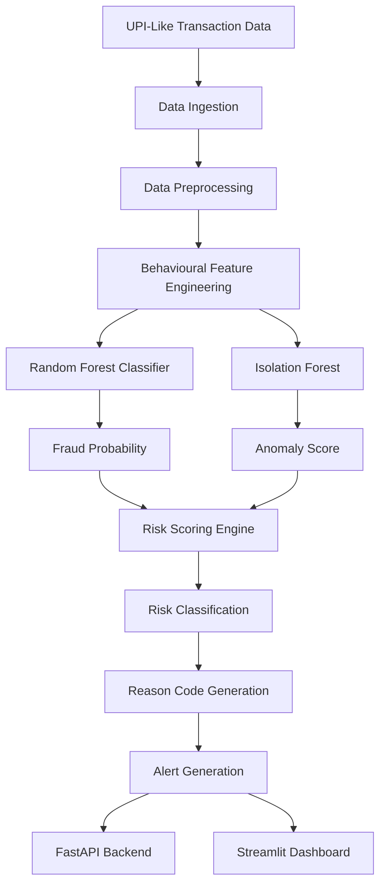

# AI-Powered Real-Time UPI Fraud Detection and Financial Crime Intelligence

**Securing Digital Payments Through Intelligent Fraud Detection, Behavioural Analytics, and AI-Powered Financial Intelligence.**

---

## Project Overview

An AI-powered financial security platform designed to detect suspicious UPI-like transaction patterns using machine learning, anomaly detection, and behavioural analytics.

The system integrates predictive modelling, transaction risk assessment, and automated security alerts to identify unusual payment activities and support proactive fraud monitoring.

It leverages algorithms such as **Random Forest, Logistic Regression, and Isolation Forest** to analyse transaction behaviour, detect potential fraudulent activities, and generate intelligent risk scores.

An interactive **Streamlit dashboard** and **FastAPI-based REST API** provide capabilities for transaction monitoring, fraud-risk assessment, analytical insights, and financial crime investigation.

## Key Objectives

- Detect potentially fraudulent UPI-like transactions using machine learning.
- Identify unusual transaction behaviour through anomaly detection.
- Analyse transaction velocity, spending patterns, and beneficiary activity.
- Generate intelligent transaction risk scores and security alerts.
- Improve prediction transparency through explainable risk indicators.
- Develop an extensible architecture for financial crime intelligence.

## Core Features

| Feature | Description |
|---|---|
| AI Fraud Detection | Machine learning-based suspicious transaction classification. |
| Anomaly Detection | Isolation Forest-based identification of unusual transaction patterns. |
| Behavioural Analytics | Analysis of transaction velocity, spending deviations, and device activity. |
| Dynamic Risk Scoring | Risk scores with Low, Medium, High, and Critical classifications. |
| Explainable Risk Indicators | Human-readable reason codes for suspicious activities. |
| Transaction Monitoring | Interactive Streamlit analytics dashboard. |
| REST API | FastAPI-based transaction risk-scoring endpoint. |
| Automated Alerts | Structured fraud-risk alert generation. |
| Synthetic Data Generation | Reproducible UPI-like transaction dataset generation. |

## System Architecture

SentinelPay follows a modular architecture integrating transaction processing, machine learning, anomaly detection, risk assessment, and financial intelligence.



## Machine Learning Architecture

SentinelPay combines supervised and unsupervised learning techniques to identify potentially fraudulent transaction behaviour.

### Supervised Learning

| Algorithm | Purpose |
|---|---|
| Logistic Regression | Baseline fraud classification. |
| Random Forest | Main supervised fraud detection model. |
| XGBoost | Planned advanced model comparison. |

### Unsupervised Learning

| Algorithm | Purpose |
|---|---|
| Isolation Forest | Detection of anomalous transaction behaviour. |

### Explainable AI

The current implementation generates interpretable risk indicators through behavioural features and rule-based reason codes.

SHAP-based model explanations are planned as a future enhancement to improve model interpretability.

## Transaction Intelligence Indicators

The platform analyses multiple transaction-level and behavioural indicators:

- Transaction amount deviations.
- Unusual transaction frequency.
- New device activity.
- New beneficiary interactions.
- Geographical distance anomalies.
- Repeated failed transaction attempts.
- Unusual spending patterns.

These indicators help prioritize suspicious transactions for further investigation.

## Risk Classification

Transactions are assigned risk categories using a weighted combination of fraud probability and anomaly score.

| Risk Score | Classification |
|---|---|
| 0–39 | 🟢 Low |
| 40–64 | 🟡 Medium |
| 65–84 | 🟠 High |
| 85–100 | 🔴 Critical |

*Risk thresholds are illustrative and should be calibrated using validation data before operational use.*

## Dataset & Data Generation

SentinelPay uses synthetic UPI-like transaction data for development, experimentation, and model evaluation.

The data generation process supports the creation of transaction records representing different payment behaviours and potentially suspicious activity patterns.

The transaction analysis considers:

- Transaction amounts and timestamps.
- Sender and beneficiary identifiers.
- Transaction frequency and velocity.
- Device activity.
- Geographical information.
- Transaction status and fraud labels.

Synthetic data enables reproducible experimentation without requiring access to confidential banking or payment information.

## Technology Stack

| Category | Technologies |
|---|---|
| Programming | Python |
| Data Processing | Pandas, NumPy |
| Machine Learning | Scikit-learn |
| Fraud Detection | Random Forest, Logistic Regression |
| Anomaly Detection | Isolation Forest |
| Backend | FastAPI |
| Dashboard | Streamlit |
| Visualization | Plotly |
| Database | SQLite |
| Data Storage | CSV |
| Development | Jupyter Notebook, VS Code |
| Version Control | Git, GitHub |

## Model Evaluation

Fraud detection performance is evaluated using metrics suitable for imbalanced classification problems.

| Metric | Purpose |
|---|---|
| Accuracy | Overall classification correctness. |
| Precision | Proportion of flagged transactions that are fraudulent. |
| Recall | Proportion of fraudulent transactions detected. |
| F1-Score | Balance between precision and recall. |
| ROC-AUC | Ranking performance across classification thresholds. |
| PR-AUC | Precision-recall performance under class imbalance. |
| Confusion Matrix | Analysis of correct and incorrect predictions. |
| False Positive Rate | Frequency of legitimate transactions incorrectly flagged. |

Model performance should be established using properly separated validation and test datasets. Synthetic-data results should not be interpreted as real-world UPI fraud detection performance.

## Installation & Setup

**1. Clone the repository**

```bash
git clone <your-repository-url>
cd SentinelPay
```

**2. Create a virtual environment**

```bash
python -m venv venv
```

**3. Activate the environment**

Windows:

```bash
venv\Scripts\activate
```

Linux / macOS:

```bash
source venv/bin/activate
```

**4. Install dependencies**

```bash
pip install -r requirements.txt
```

**5. Generate synthetic transaction data**

```bash
python scripts/generate_data.py
```

**6. Train the fraud detection model**

```bash
python scripts/train_model.py
```

**7. Launch the Streamlit dashboard**

```bash
streamlit run dashboard/app.py
```

**8. Start the FastAPI backend**

```bash
uvicorn api.main:app --reload
```

Access the API documentation at:

`http://127.0.0.1:8000/docs`

*Commands assume the corresponding scripts and application files are implemented in the repository.*

## Repository Structure

```text
SentinelPay/
│
├── api/
│   └── main.py
│
├── dashboard/
│   └── app.py
│
├── data/
│   ├── raw/
│   ├── processed/
│   ├── sample/
│   └── README.md
│
├── docs/
│   ├── 01_Project_Proposal.md
│   ├── 02_Abstract.md
│   ├── 03_Introduction.md
│   ├── 04_Problem_Statement.md
│   ├── 05_Literature_Review.md
│   ├── 06_Objectives_and_Scope.md
│   ├── 07_System_Requirements.md
│   ├── 08_System_Architecture.md
│   ├── 09_Methodology.md
│   ├── 10_Dataset_Documentation.md
│   ├── 11_Feature_Engineering.md
│   ├── 12_Model_Development.md
│   ├── 13_Model_Evaluation.md
│   ├── 14_Explainable_AI.md
│   ├── 15_Risk_Scoring.md
│   ├── 16_Financial_Crime_Intelligence.md
│   ├── 17_Testing_and_Validation.md
│   ├── 18_Deployment_Guide.md
│   ├── 19_Security_and_Privacy.md
│   ├── 20_Limitations_and_Future_Work.md
│   └── references.md
│
├── models/
│
├── notebooks/
│   ├── 01_Data_Exploration.ipynb
│   ├── 02_Data_Preprocessing.ipynb
│   ├── 03_Feature_Engineering.ipynb
│   ├── 04_Fraud_Detection_Models.ipynb
│   ├── 05_Anomaly_Detection.ipynb
│   └── 06_Model_Evaluation.ipynb
│
├── reports/
│   ├── evaluation/
│   └── figures/
│
├── scripts/
│   ├── generate_data.py
│   ├── train_model.py
│   └── run_pipeline.py
│
├── src/
│   └── sentinelpay/
│       ├── data_generator.py
│       ├── preprocessing.py
│       ├── feature_engineering.py
│       ├── train.py
│       ├── predict.py
│       ├── risk_scoring.py
│       ├── anomaly_detection.py
│       ├── explainability.py
│       ├── alerts.py
│       └── database.py
│
├── tests/
│   ├── test_features.py
│   ├── test_prediction.py
│   ├── test_preprocessing.py
│   └── test_risk_scoring.py
│
├── config.yaml
├── requirements.txt
├── .env.example
├── .gitignore
├── LICENSE
└── README.md
```

## Future Enhancements

- Real-time transaction stream processing using Apache Kafka.
- Advanced fraud classification using XGBoost.
- SHAP-based explainable AI visualizations.
- Graph Neural Networks for suspicious transaction network analysis.
- Suspicious beneficiary relationship discovery.
- PostgreSQL integration for scalable transaction storage.
- Advanced fraud investigation and case management.
- Concept drift monitoring and model retraining.
- Docker-based deployment and cloud infrastructure.
- Advanced financial crime intelligence dashboard.

## Security & Responsible AI

SentinelPay is developed as an educational and research-oriented prototype.

- Uses synthetic transaction data by default.
- Does not connect to actual UPI or banking infrastructure.
- Does not store UPI PINs, OTPs, passwords, or payment credentials.
- Fraud-risk predictions are indicators for investigation, not proof of criminal activity.
- Human review is essential before any consequential financial action.

## Documentation 

Explore the [`docs/`](docs/) directory for detailed project documentation, including:

- Project proposal and abstract.
- Problem definition and research objectives.
- Literature review and system architecture.
- Dataset and feature engineering.
- Machine learning methodology.
- Model evaluation and explainability.
- Risk scoring and financial crime intelligence.
- Testing, security, and deployment.
- Limitations and future enhancements.

## Author

**Mohamed Riyaz S.**  
Integrated M.Tech – Computer Science and Engineering (Business Analytics)  
Vellore Institute of Technology (VIT), Chennai
