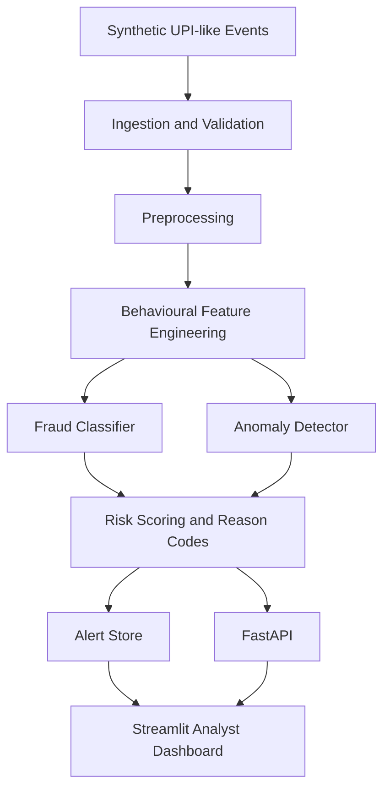

# System Architecture

### Components
- Generator: creates safe, reproducible synthetic events.
- Preprocessor: validates schema and handles missing values.
- Feature engine: derives velocity, novelty and amount-deviation features.
- Classifier: supervised baseline.
- Anomaly detector: independent outlier signal.
- Risk engine: combines signals using documented weights.
- Alert layer: emits review candidates and reason codes.
- API/dashboard: serving and visualization.

A future deployment may introduce Kafka/Redpanda, a feature store, PostgreSQL, model registry, observability and role-based access controls.
